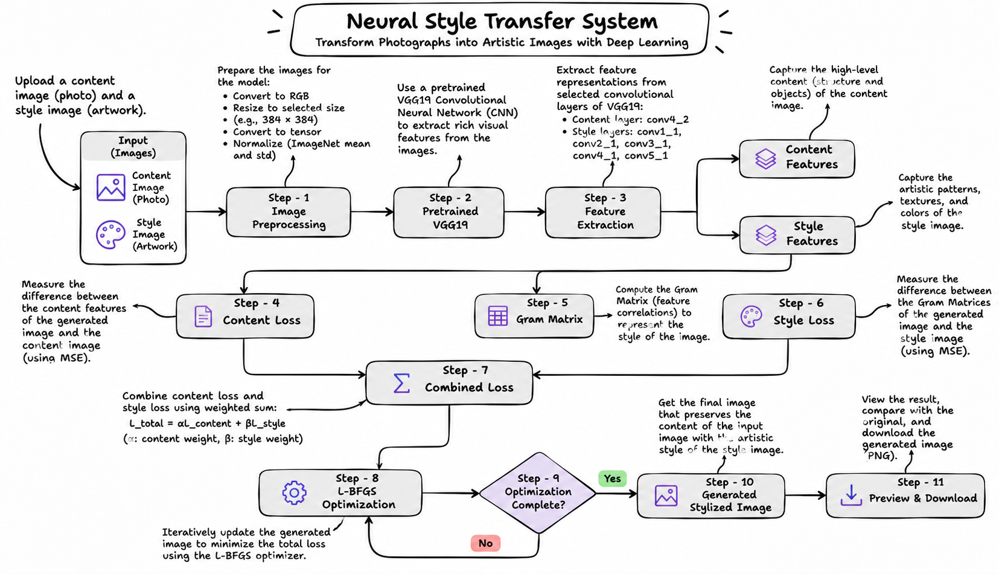

<div align = "center">

# Neural Style Transfer System

    
### Transform Photographs into Artistic Images with Deep Learning

A web-based **Neural Style Transfer (NST)** application that combines the content of one image with the artistic style of another using a pretrained **VGG19 Convolutional Neural Network**, Gram Matrix-based style loss, and L-BFGS optimization.

[](https://python.org)
[](https://pytorch.org/)
[](https://fastapi.tiangolo.com/)
[](https://pytorch.org/vision/stable/models/generated/torchvision.models.vgg19.html)
[](https://developer.mozilla.org/en-US/docs/Web/JavaScript)

---

**One photograph. One artistic reference. A completely new visual creation.**

</div>

---

## The Problem

A photograph may contain the subject and structure we want to preserve, while a painting or another artwork contains colors, textures, and visual patterns we want to reproduce.

Combining these characteristics manually can require substantial image-editing effort. The central challenge is to preserve the original image's content while transferring the artistic appearance of a separate reference image.

## The Solution

The **Neural Style Transfer System** automates this process using deep learning.

Users provide two images:

- **Content Image:** Supplies the objects, structure, and composition.
- **Style Image:** Supplies the artistic textures, patterns, and visual appearance.

A pretrained VGG19 network extracts visual features from both images. The system calculates content loss and style loss, then uses an L-BFGS optimizer to iteratively update the generated image.

A web interface lets users upload images, adjust style strength and optimization settings, monitor progress, compare the result with the original, and download the generated PNG.

---

## Features

| Feature | Description |
| --- | --- |
| **Content Image Upload** | Upload the photograph whose structure should be preserved |
| **Style Image Upload** | Upload a painting or reference image for artistic style |
| **VGG19 Feature Extraction** | Extract visual features from a pretrained VGG19 network |
| **Gram Matrix** | Represent style through correlations between feature maps |
| **Content and Style Loss** | Balance content preservation with style transfer |
| **L-BFGS Optimization** | Iteratively optimize the generated image |
---

## System Architecture

The following diagram illustrates the complete workflow of the Neural Style Transfer System.



## Architecture

The system has three main parts:

1. **Frontend:** Handles image uploads, settings, generation requests, progress display, comparison, and downloads.
2. **FastAPI Backend:** Validates uploaded images, creates background jobs, exposes API endpoints, and serves the frontend.
3. **NST Engine:** Extracts VGG19 features, computes content and style losses, and optimizes the generated image using L-BFGS.


## Tech Stack

| Category | Technology |
| --- | --- |
| **Programming Language** | Python |
| **Deep Learning Framework** | PyTorch |
| **Computer Vision Model** | Pretrained VGG19 |
| **Style Representation** | Gram Matrix |
| **Optimization Algorithm** | L-BFGS |
| **Image Processing** | Pillow (PIL) |
| **Backend Framework** | FastAPI |
| **API Server** | Uvicorn |
| **Data Validation** | Pydantic |
| **Frontend** | HTML5, CSS3, JavaScript |
| **API Communication** | Fetch API, REST endpoints |

---

## Project Structure

```text
Project6_Neural-Style-Transfer-System/
│
├── NST.ipynb                  # Original Neural Style Transfer notebook
│
├── backend/
│   ├── main.py                # FastAPI application and API endpoints
│   └── nst_engine.py          # Neural Style Transfer engine
│
├── frontend/
│   ├── index.html             # Web application structure
│   ├── styles.css             # Frontend styling
│   └── app.js                 # Upload, API, progress, and result handling
│
├── requirements.txt           # Python dependencies
├── .gitignore                 # Ignored files and folders
└── README.md                  # Project documentation
```

---

## Getting Started

### Installation

1. **Clone the repository**

   ```bash
   git clone https://github.com/diyapandya/Project6_Neural-Style-Transfer-System.git
   cd Project6_Neural-Style-Transfer-System
   ```

2. **Create a virtual environment**

   ```bash
   python -m venv venv
   ```

3. **Activate the environment**

   Windows PowerShell:

   ```powershell
   .\venv\Scripts\Activate.ps1
   ```

4. **Install dependencies**

   ```bash
   pip install -r requirements.txt
   ```

5. **Start the backend**

   ```bash
   cd backend
   uvicorn main:app --reload --port 8000
   ```

6. **Open the application**

   Visit:

   ```text
   http://localhost:8000
   ```

   FastAPI serves the frontend, so a separate frontend server is not required.

---

## How the Web Application Works

Image optimization can take several seconds or minutes depending on resolution, step count, and hardware. The backend therefore handles each generation request as a background job.

1. The user uploads content and style images.
2. The frontend sends the images and selected settings to `POST /api/generate`.
3. FastAPI validates the uploads and creates a unique job ID.
4. A background thread runs the NST engine.
5. The frontend polls the job-status endpoint for progress.
6. The backend reports status, progress, losses, and elapsed time.
7. When the job is complete, the frontend fetches the generated PNG.
8. The user previews, compares, and downloads the result.

---

## API Reference

| Method | Endpoint | Purpose |
| --- | --- | --- |
| **GET** | `/api/health` | Checks backend availability and reports the selected processing device |
| **POST** | `/api/generate` | Uploads images, accepts settings, and starts a background job |
| **GET** | `/api/jobs/{job_id}` | Returns job status, progress, step count, losses, and elapsed time |
| **GET** | `/api/jobs/{job_id}/result` | Returns the generated PNG when the job is complete |
| **DELETE** | `/api/jobs/{job_id}` | Removes a job from the in-memory job store |

The endpoint returns a unique `job_id`, which is used to monitor the generation process and retrieve the result.


## Developer

Connect with the project developer:

[](https://github.com/diyapandya)

[](https://www.linkedin.com/in/diya-pandya-399b382b1/)

---

## License

This project is developed for educational and learning purposes.

---

<div align="center">

**Neural Style Transfer System — Where Deep Learning Meets Digital Art.**

</div>
